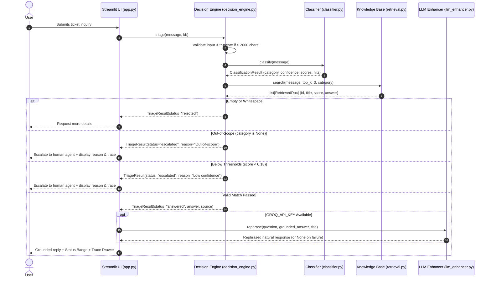

# Support Ticket Triage & Retrieval Engine

A deterministic, confidence-gated Tier-1 customer support triage and grounded FAQ retrieval engine for software-as-a-service (SaaS) inquiries.

The engine automates front-line ticket handling by classifying customer messages into **Billing**, **Technical**, and **Account Access**, retrieving verified answers from a curated knowledge base using **TF-IDF cosine similarity**, and enforcing **strict, inspectable confidence thresholds**. Whenever an inquiry falls outside supported categories or lacks a confident match, the system safely **escalates to a human support agent** with a concrete, auditable explanation.

---

## Table of Contents

- [Project Overview](#project-overview)
- [Problem Statement](#problem-statement)
- [Proposed Solution](#proposed-solution)
- [Key Features](#key-features)
- [System Architecture](#system-architecture)
- [How It Works (Step-by-Step)](#how-it-works-step-by-step)
- [Data Flow & Decision Pipeline](#data-flow--decision-pipeline)
- [Technology Stack](#technology-stack)
- [Project Structure](#project-structure)
- [Technical Implementation Details](#technical-implementation-details)
  - [1. Intent Classifier (`classifier.py`)](#1-intent-classifier-classifierpy)
  - [2. Lexical Retrieval Engine (`retrieval.py`)](#2-lexical-retrieval-engine-retrievalpy)
  - [3. Triage & Decision Policy Engine (`decision_engine.py`)](#3-triage--decision-policy-engine-decision_enginepy)
  - [4. Optional LLM Rephrasing Layer (`llm_enhancer.py`)](#4-optional-llm-rephrasing-layer-llm_enhancerpy)
  - [5. Streamlit Chat Interface (`app.py`)](#5-streamlit-chat-interface-apppy)
- [Installation & Setup](#installation--setup)
- [Environment Configuration](#environment-configuration)
- [How to Run](#how-to-run)
- [Usage Instructions](#usage-instructions)
- [Empirical Input and Output Examples](#empirical-input-and-output-examples)
- [Internal API Reference](#internal-api-reference)
- [Data Management](#data-management)
- [Testing & Verification](#testing--verification)
- [Verified Project Metrics](#verified-project-metrics)
- [Current Implementation Status](#current-implementation-status)
- [Limitations & Known Technical Constraints](#limitations--known-technical-constraints)
- [Future Improvements](#future-improvements)
- [Contributing](#contributing)
- [License](#license)
- [Acknowledgements](#acknowledgements)

---

## Project Overview

Modern customer support organizations receive repetitive, high-volume inquiries regarding billing, technical hiccups, and account permissions. Naive generative AI chatbots frequently fail in enterprise settings due to hallucinations, unpredictable decision boundaries, and black-box prompt chains that offer zero operational visibility.

**Support Ticket Triage & Retrieval Engine** addresses this challenge through an **extractive-first, inspectable, and deterministic architecture**. Operating as a Tier-1 support pipeline:
1. It validates and categorizes incoming support inquiries without non-deterministic LLM classifiers.
2. It retrieves answers directly from a verified knowledge base, ensuring responses are 100% grounded in verified internal documentation.
3. It subjects every inquiry to an explicit decision policy: if the category confidence or retrieval similarity fails strict safety thresholds, it halts automated answering and flags the ticket for human escalation.
4. It logs every decision step in an auditable trace, allowing support supervisors to inspect why an answer was provided or why an escalation occurred.
5. It offers an optional, decoupled natural language rephrasing layer via Groq (Llama 3.1 8B) that only rewords pre-grounded text and silently falls back to literal knowledge base text on any failure.

---

## Problem Statement

Automating front-line customer support presents three core engineering challenges:

1. **Hallucination Risk:** Generative language models frequently invent refund timelines, fabricate account management steps, or promise features that do not exist.
2. **Opacity of Black-Box Prompts:** When an LLM fails or gives an erroneous escalation, engineering teams cannot debug internal model weights or prompt drift.
3. **Keyword False Positives & Out-of-Scope Requests:** Lexical search engines often match non-support queries to knowledge articles based on accidental word overlap (for example, matching *"Can you help me plan a birthday party?"* to a *"Subscription Plan"* FAQ).

---

## Proposed Solution

The **Support Ticket Triage & Retrieval Engine** solves these problems using layered guardrails:

- **Zero-Cost, Zero-Hallucination Core:** Runs completely offline without external API dependencies. Answers are extracted verbatim from internal knowledge base articles unless optional rephrasing is explicitly configured.
- **Inspectable Decision Policy:** All decision logic is implemented in explicit Python branches with numerical thresholds, producing a chronological execution trace for every message.
- **Conservative Two-Stage Gating:** An inquiry must pass *both* category classification and lexical retrieval thresholds. If a message contains no category keywords, it is marked out-of-scope and escalated immediately, neutralizing lexical overlap false positives.

---

## Key Features

- **Rule-Based Intent Classification:** Deterministic, keyword-weighted scoring with lightweight heuristic stemming across Billing, Technical, and Account Access.
- **Lexical Vector Search (TF-IDF):** Unigram/bigram tokenization and cosine similarity scoring against structured FAQ articles.
- **Grounded Extractive Answers:** Delivers verbatim, verified text from documentation, eliminating factual hallucination.
- **Multi-Condition Escalation Engine:** Evaluates category confidence against a `0.35` threshold and retrieval similarity against an `0.18` threshold, escalating out-of-scope, low-confidence, or ambiguous requests.
- **Auditable Execution Trace:** Captures classifier scores, matched tokens, retrieval ranks, similarity metrics, and decision branch rationale in an inspectable trace.
- **Optional Decoupled LLM Rephraser:** Integrates Groq (`llama-3.1-8b-instant`) with strict prompt constraints to enhance tone without introducing ungrounded facts. Includes graceful fallback on rate limits, missing keys, or timeouts.
- **Interactive Streamlit Interface:** Features real-time status badges (`ANSWERED`, `ESCALATED`, `REJECTED`), source attribution links, one-click sample inputs, knowledge base browsing, and an expandable reasoning inspector.
- **Thorough Test Suite:** 16 automated unit and integration tests verifying classification, edge-case rejection, false-positive prevention, truncation, and simulated retrieval outages.

---

## System Architecture

```
                                  +-----------------------+
                                  | User Support Message  |
                                  +-----------+-----------+
                                              |
                                              v
                              +-------------------------------+
                              |    Input Validation Layer     |
                              |  - Empty / Whitespace Check   |
                              |  - Max 2000 Chars Truncation  |
                              +---------------+---------------+
                                              |
                        +---------------------+---------------------+
                        |                                           |
                        v                                           v
         +-----------------------------+             +-----------------------------+
         |     Intent Classifier       |             |   Lexical Retrieval Engine  |
         |       (classifier.py)       |             |       (retrieval.py)        |
         | - Suffix-stripping stemmer  |             | - scikit-learn TF-IDF       |
         | - Weighted keyword scoring  |             | - Cosine similarity scoring |
         | - Normalized confidence     |             | - Category-filtered search  |
         +--------------+--------------+             +--------------+--------------+
                        |                                           |
                        +---------------------+---------------------+
                                              |
                                              v
                              +-------------------------------+
                              |    Triage & Decision Engine   |
                              |     (decision_engine.py)      |
                              | - Confidence check (< 0.35)   |
                              | - Retrieval check  (< 0.18)   |
                              | - Out-of-scope guardrail      |
                              | - Generates execution trace   |
                              +---------------+---------------+
                                              |
                     +------------------------+------------------------+
                     |                        |                        |
         [status == "rejected"]     [status == "escalated"]    [status == "answered"]
                     |                        |                        |
                     v                        v                        v
            Prompt User for            Route to Human           Grounded KB Answer
             Clearer Input              Support Agent            + Source Document
                                       (with Reason)                   |
                                                                       v
                                                        +-----------------------------+
                                                        |    Optional LLM Enhancer    |
                                                        |      (llm_enhancer.py)      |
                                                        | - Groq / Llama 3.1 8B       |
                                                        | - Tone rephrasing only      |
                                                        | - Fallback to literal text  |
                                                        +--------------+--------------+
                                                                       |
                                                                       v
                                                        +-----------------------------+
                                                        |     Streamlit Chat UI       |
                                                        |          (app.py)           |
                                                        | - Status & Category Badges  |
                                                        | - Source Attribution        |
                                                        | - Inspectable Trace Drawer  |
                                                        +-----------------------------+
```

---

## How It Works (Step-by-Step)

1. **Message Submission:** The user enters an inquiry in the Streamlit chat interface (e.g., *"I was charged twice for my subscription this month, why?"*).
2. **Sanitization & Validation:** The input is validated in [decision_engine.py](decision_engine.py). Empty or whitespace-only messages are tagged as `rejected`. Inquiries exceeding 2,000 characters are safely truncated to avoid memory and vectorizer degradation.
3. **Intent Classification:** [classifier.py](classifier.py) tokenizes and stems the message, evaluates weighted keyword matches across Billing, Technical, and Account Access, and computes normalized confidence scores.
4. **Knowledge Retrieval:** [retrieval.py](retrieval.py) transforms the query using a fitted TF-IDF vectorizer and calculates cosine similarity against the 15 knowledge base articles. If a category was predicted, it searches within that category first, falling back to global search if no match is found.
5. **Policy Decision:** [decision_engine.py](decision_engine.py) applies deterministic escalation rules:
   - If no category keywords matched (`category is None`), the inquiry is escalated as **Out-of-Scope**.
   - If category confidence is below `0.35` AND retrieval similarity is below `0.18`, it is escalated for **Low Confidence**.
   - If retrieval similarity is below `0.18`, it is escalated to avoid an ungrounded answer.
   - If all thresholds pass, the inquiry is marked `answered` using the top retrieved document.
6. **Optional Rephrasing:** If `GROQ_API_KEY` is configured in the environment, [llm_enhancer.py](llm_enhancer.py) passes the user question and grounded answer to Groq (`llama-3.1-8b-instant`) to soften the tone. If the key is absent or an error occurs, the verbatim knowledge base answer is used.
7. **Presentation & Trace Inspection:** [app.py](app.py) renders the response, displays metadata badges, and populates the expandable **Inspect reasoning trace** panel.

---

## Data Flow & Decision Pipeline

The following sequence diagram illustrates the lifecycle of a request:



---

## Technology Stack

### Core Frameworks & Libraries (from `requirements.txt`)
- **Python 3.10+** (Tested on Python 3.14.0)
- **[Streamlit](https://streamlit.io/) (1.62.0):** Interactive chat UI, state management, and real-time trace inspection.
- **[scikit-learn](https://scikit-learn.org/) (1.8.0):** Lexical feature extraction (`TfidfVectorizer`) and vector similarity computation (`cosine_similarity`).
- **[NumPy](https://numpy.org/) (2.4.4):** Array manipulation and vector operations.
- **[pytest](https://docs.pytest.org/) (9.1.1):** Automated unit and integration testing.
- **[groq](https://github.com/groq/groq-python) (1.6.0):** Optional inference client for Llama 3.1 8B natural language rephrasing.

### Standard Library Components
- `dataclasses`: Strongly typed data containers (`ClassificationResult`, `RetrievedDoc`, `TriageResult`).
- `re`: Regular expressions for tokenization and keyword boundary matching.
- `json`: Parsing of synthetic knowledge base and test ticket fixtures.
- `pathlib`: Cross-platform filesystem path resolution.
- `os`: Environment variable retrieval.

---

## Project Structure

```
Support_Ticket_Triage_and_Retrieval_Engine/
├── .env.example              # Template for optional GROQ_API_KEY
├── .gitignore                # Git ignore patterns for venv, caches, and env files
├── .streamlit/
│   └── config.toml           # Streamlit server config (headless mode, light theme)
├── app.py                    # Streamlit web application and chat UI entry point
├── classifier.py             # Keyword-weighted rule classifier and heuristic stemmer
├── decision_engine.py        # Triage policy engine, confidence gating, and trace logger
├── llm_enhancer.py           # Optional Groq-based Llama 3.1 8B answer rephraser
├── retrieval.py              # TF-IDF knowledge base search and cosine similarity
├── requirements.txt          # Pinned production and development dependencies
├── README.md                 # Complete system documentation
├── data/
│   ├── knowledge_base.json   # 15 synthetic FAQ articles across 3 categories
│   └── mock_tickets.json     # 10 test tickets covering standard and edge cases
└── tests/
    └── test_pipeline.py      # 16 unit and integration tests (pytest)
```

---

## Technical Implementation Details

### 1. Intent Classifier (`classifier.py`)
- **Category Coverage:** `Billing`, `Technical`, `Account Access`.
- **Heuristic Stemmer (`_stem`):** Strips common suffixes (`-ing`, `-ed`, `-es`, `-s`) with minimum character length checks to normalize variants (e.g., `crash`, `crashed`, `crashing`) without requiring heavy NLP dependencies like NLTK or spaCy.
- **Keyword Scoring:** Evaluates multi-word phrases directly (e.g., `credit card: 1.3`, `double charge: 1.4`, `locked out: 1.4`) and single tokens via stemmed lookups.
- **Normalization:** Raw scores are summed and normalized into a probability distribution:
  $$\text{confidence} = \frac{\text{score}(\text{best\_category})}{\sum_{c} \text{score}(c)}$$
- **Low Confidence Threshold:** Fixed at `LOW_CONFIDENCE_THRESHOLD = 0.35`.

### 2. Lexical Retrieval Engine (`retrieval.py`)
- **Corpus Construction:** Combines each article's `title`, `question`, and `keywords` array into an indexed document corpus.
- **Vector Space Model:** Fits a `TfidfVectorizer(stop_words="english")` over the corpus.
- **Search Execution:** Transforms incoming queries into TF-IDF vector space, runs `cosine_similarity`, and sorts documents in descending order.
- **Filtered & Fallback Strategy:** If a category is supplied by the classifier, results are filtered by `category == doc["category"]`. If category-filtered search returns zero hits, it automatically falls back to an unfiltered search across all documents.
- **Retrieval Threshold:** Fixed at `RETRIEVAL_CONFIDENCE_THRESHOLD = 0.18`.

### 3. Triage & Decision Policy Engine (`decision_engine.py`)
Coordinates validation, classification, and retrieval into a unified decision object (`TriageResult`):
- **Input Validation:** Messages with length `0` or containing only whitespace return `status = "rejected"`. Messages exceeding `MAX_MESSAGE_LEN = 2000` characters are truncated.
- **Error Handling:** If `kb.search()` raises an unhandled exception, the engine catches it and escalates with an explicit message: `"Internal retrieval error - could not search the knowledge base."`
- **Policy Order:**
  1. `cls.category is None` $\rightarrow$ **ESCALATE** (*Out-of-Scope*). Prevents false positives from common words shared between unrelated queries and FAQ articles.
  2. `cls.is_low_confidence` and `top_score < 0.18` $\rightarrow$ **ESCALATE** (*Low Confidence*).
  3. `top_score < 0.18` $\rightarrow$ **ESCALATE** (*Ungrounded Knowledge Match*).
  4. Passes all checks $\rightarrow$ **ANSWER** (*Grounded in top retrieved document*).

### 4. Optional LLM Rephrasing Layer (`llm_enhancer.py`)
- **Model:** `llama-3.1-8b-instant` via the official `groq` SDK.
- **Temperature & Token Limits:** `temperature=0.2`, `max_tokens=300`.
- **System Guardrail:** The prompt instructs the model:
  > *"Rewrite the ANSWER below in a warm, natural tone for the CUSTOMER_QUESTION. Do not add any information that is not already in the ANSWER. Do not remove any instructions or steps. Keep it concise."*
- **Fail-Safe Operation:** Bounded in a broad `try/except` block. If `GROQ_API_KEY` is absent, or if a network timeout, rate limit, or API failure occurs, it returns `None`, and the application automatically serves the literal knowledge base answer.

### 5. Streamlit Chat Interface (`app.py`)
- **Layout & Caching:** Configured in wide layout with `@st.cache_resource` on `KnowledgeBase()` loading to avoid re-vectorizing the corpus on every user interaction.
- **Interactive Sidebar:** Displays the article count (15), LLM status (`enabled (Groq)` or `disabled (extractive mode)`), an expandable knowledge base browser, and 5 one-click sample prompts.
- **Chat Feed:** Displays user and assistant messages with color-coded status badges:
  - `:green[ANSWERED]`
  - `:orange[ESCALATED]`
  - `:red[REJECTED]`
- **Source & Trace Inspection:** Includes source attribution links (e.g., `Source: [BIL-003] Understanding your invoice`) and an expandable **Inspect reasoning trace** section detailing step-by-step logs and candidate scores.

---

## Installation & Setup

### Prerequisites
- **Python:** Version 3.10 or higher (Verified on Python 3.14.0)
- **Git:** Installed and configured
- **Operating System:** Windows, macOS, or Linux

### Clone Repository & Setup Environment

```bash
# Clone the repository
git clone https://github.com/KrishPatel-AI/Support_Ticket_Triage_and_Retrieval_Engine.git
cd Support_Ticket_Triage_and_Retrieval_Engine

# Create a virtual environment
python -m venv venv

# Activate virtual environment
# On Windows (PowerShell):
.\venv\Scripts\Activate.ps1
# On Windows (CMD):
.\venv\Scripts\activate.bat
# On macOS / Linux:
source venv/bin/activate

# Upgrade pip and install dependencies
pip install -r requirements.txt
```

---

## Environment Configuration

The engine runs out of the box in **100% extractive, local mode without any API keys**.

### Optional: Enable Groq LLM Rephrasing
If you wish to enable natural-language rephrasing:
1. Obtain a free API key from [Groq Console](https://console.groq.com/keys).
2. Create a `.env` file in the project root based on [.env.example](.env.example):
   ```bash
   cp .env.example .env
   ```
3. Set your key inside `.env` or export it in your shell:
   ```bash
   # Windows PowerShell:
   $env:GROQ_API_KEY="gsk_your_actual_key_here"

   # Windows CMD:
   set GROQ_API_KEY=gsk_your_actual_key_here

   # macOS / Linux:
   export GROQ_API_KEY="gsk_your_actual_key_here"
   ```

---

## How to Run

Launch the Streamlit web application:

```bash
streamlit run app.py
```

Once started, open your web browser at:
```
http://localhost:8501
```

---

## Usage Instructions

1. **Enter Inquiries:** Type your support question in the input bar at the bottom of the screen (or click any of the sample queries in the left sidebar).
2. **Review Triage Status:**
   - If the system is confident, it displays an `:green[ANSWERED]` badge along with the exact source article ID.
   - If the system is unconfident or the inquiry is outside support scope, it displays an `:orange[ESCALATED]` warning explaining why the ticket was handed over to a human.
3. **Inspect the Reasoning Trace:** Click the **Inspect reasoning trace** dropdown beneath any assistant response to view the raw classifier scores, matched tokens, retrieval scores, and decision rationale.
4. **Browse Knowledge Base:** Expand the **View knowledge base** section in the sidebar to review all 15 indexed articles.
5. **Reset Conversation:** Click **Clear conversation** in the sidebar to reset session state.

---

## Empirical Input and Output Examples

The following examples were executed against the live engine and verified against the test dataset:

### Example 1: Confident Billing Inquiry (Answered)
- **User Message:** `"I was charged twice for my subscription this month, why?"`
- **Status:** `ANSWERED`
- **Category:** `Billing` (Confidence: `1.00`)
- **Matched Keywords:** `['charged', 'subscription', 'charged twice']`
- **Top Retrieval Doc:** `BIL-003` (*Understanding your invoice*) with similarity score `0.592`
- **Assistant Response (Extractive):**
  > Duplicate charges usually happen when a plan upgrade is processed mid-cycle, generating a prorated charge alongside the regular renewal. Check Settings > Billing > Invoice History; each line item lists the reason. If you still see an unexplained duplicate, escalate to billing support with the invoice ID.
- **Trace Output:**
  ```text
  Classifier: category=Billing, confidence=1.00 (threshold=0.35), matched_keywords={'Billing': ['charged', 'subscription', 'charged twice'], 'Technical': [], 'Account Access': []}
  Retrieval: top_match=BIL-003, score=0.592 (threshold=0.18)
  Decision: ANSWER using source BIL-003 (Understanding your invoice), score=0.592
  ```

---

### Example 2: Out-of-Scope Inquiry with Lexical Overlap (Escalated)
- **User Message:** `"Can you help me plan a birthday party for my dog?"`
- **Underlying Challenge:** The word `"plan"` matches article `BIL-004` (*"How do I upgrade or downgrade my subscription plan?"*), producing a superficial similarity score of `0.512`.
- **Status:** `ESCALATED`
- **Category:** `None` (Confidence: `0.00`)
- **Escalation Reason:**
  > *Out-of-scope: the message does not contain any keywords associated with Billing, Technical, or Account Access, so it is treated as outside the supported ticket scope even if a knowledge-base article superficially matched.*
- **Assistant Response:**
  > I'm not confident I can answer this accurately from our knowledge base, so I've escalated it to a human support agent who will follow up with you shortly.

---

### Example 3: Account Lockout (Answered)
- **User Message:** `"I can't log in, it says my account is locked"`
- **Status:** `ANSWERED`
- **Category:** `Account Access` (Confidence: `1.00`)
- **Top Retrieval Doc:** `ACC-002` (*I'm locked out of my account*) with similarity score `0.970`
- **Assistant Response (Extractive):**
  > Accounts are temporarily locked after 5 failed login attempts. Wait 15 minutes for the lockout to expire, or use the 'Forgot Password' link on the login screen to reset your credentials immediately. If your account was locked by an administrator, contact your workspace owner.

---

### Example 4: Empty / Invalid Message (Rejected)
- **User Message:** `""` (Empty string or whitespace)
- **Status:** `REJECTED`
- **Category:** `None` (Confidence: `0.00`)
- **Assistant Response:**
  > It looks like your message was empty. Could you tell me a bit more about the issue you're facing?

---

## Internal API Reference

### `classifier.py`

#### `classify(message: str) -> ClassificationResult`
Classifies an input text string into one of three categories or returns `None`.

```python
@dataclass
class ClassificationResult:
    category: str | None
    confidence: float
    scores: dict[str, float]
    matched_keywords: dict[str, list[str]]
    is_low_confidence: bool
```

---

### `retrieval.py`

#### `class KnowledgeBase(path: Path = KB_PATH)`
Loads and vectorizes the knowledge base JSON corpus.

#### `search(query: str, top_k: int = 3, category: str | None = None) -> list[RetrievedDoc]`
Transforms `query` to TF-IDF space and returns the top-k highest scoring documents.

```python
@dataclass
class RetrievedDoc:
    id: str
    title: str
    category: str
    answer: str
    score: float
```

---

### `decision_engine.py`

#### `triage(message: str, kb: KnowledgeBase) -> TriageResult`
Orchestrates validation, classification, retrieval, and policy logic.

```python
@dataclass
class TriageResult:
    status: str                         # "answered" | "escalated" | "rejected"
    category: ClassificationResult
    top_matches: list[RetrievedDoc]
    answer: str | None
    escalation_reason: str | None
    trace: list[str]                    # Chronological execution log
```

---

### `llm_enhancer.py`

#### `is_enabled() -> bool`
Returns `True` if `GROQ_API_KEY` is present in the environment.

#### `rephrase(user_question: str, grounded_answer: str, source_title: str) -> str | None`
Rewrites the grounded answer in a natural tone. Returns `None` if disabled or on any API failure.

---

## Data Management

### Knowledge Base Schema (`data/knowledge_base.json`)
Contains 15 synthetic articles across three categories (5 articles per category):

```json
{
  "id": "BIL-001",
  "category": "Billing",
  "title": "How do I update my payment method?",
  "question": "How do I update my payment method or credit card?",
  "answer": "Go to Settings > Billing > Payment Methods, click 'Add New Card'...",
  "keywords": ["update payment", "change card", "credit card", "payment method"]
}
```

### Mock Test Tickets (`data/mock_tickets.json`)
Contains 10 curated test tickets representing:
- 2 Billing tickets (`T-01`, `T-04`)
- 2 Technical tickets (`T-02`, `T-05`)
- 2 Account Access tickets (`T-03`, `T-06`)
- 3 Out-of-scope / adversarial tickets (`T-07` weather, `T-08` gibberish, `T-09` lexical overlap)
- 1 Empty ticket (`T-10`)

---

## Testing & Verification

The project includes 16 automated tests in [tests/test_pipeline.py](tests/test_pipeline.py) covering the entire pipeline.

### Running the Test Suite

```bash
# Recommended execution using the virtual environment's Python binary:
python -m pytest tests/ -v
```

### Test Coverage Breakdown

| Test Function | Target Component | Verification Objective |
| :--- | :--- | :--- |
| `test_classify_billing` | `classifier.py` | Validates Billing classification on subscription charge inputs. |
| `test_classify_technical` | `classifier.py` | Validates Technical classification on crash and sync inputs. |
| `test_classify_account_access` | `classifier.py` | Validates Account Access classification on password/lockout inputs. |
| `test_classify_empty` | `classifier.py` | Verifies empty string returns `None` and `0.0` confidence. |
| `test_classify_gibberish_low_confidence` | `classifier.py` | Ensures nonsense tokens trigger low confidence or `None`. |
| `test_retrieval_returns_relevant_doc` | `retrieval.py` | Ensures password queries retrieve Account Access documents. |
| `test_retrieval_empty_query` | `retrieval.py` | Confirms empty query returns an empty list `[]`. |
| `test_triage_answers_clear_billing_question` | `decision_engine.py` | Verifies full pipeline returns `status == "answered"` for valid invoice query. |
| `test_triage_escalates_out_of_scope` | `decision_engine.py` | Verifies weather queries escalate with an explicit reason. |
| `test_triage_rejects_empty_input` | `decision_engine.py` | Verifies empty input returns `status == "rejected"`. |
| `test_triage_rejects_whitespace_input` | `decision_engine.py` | Verifies whitespace-only input returns `status == "rejected"`. |
| `test_triage_handles_all_three_categories` | `decision_engine.py` | Validates end-to-end triage routing across Billing, Technical, and Account Access. |
| `test_triage_gibberish_escalates_or_rejects` | `decision_engine.py` | Asserts gibberish is never confidently answered. |
| `test_triage_unrelated_topic_never_answered_on_word_overlap` | `decision_engine.py` | **Regression Guard:** Asserts queries sharing words with FAQs (e.g. *"birthday party plan"*) are escalated as out-of-scope. |
| `test_triage_very_long_input_is_truncated_not_crashed` | `decision_engine.py` | Confirms inputs exceeding 2,000 characters are safely handled. |
| `test_retrieval_failure_is_handled` | `decision_engine.py` | Monkeypatches retrieval with an exception to verify safe escalation on outage. |

### Verified Test Run Output
```text
============================= test session starts =============================
platform win32 -- Python 3.14.0, pytest-9.1.1, pluggy-1.7.0
rootdir: E:\Projects\Assessments\Support_Ticket_Triage_and_Retrieval_Engine
collected 16 items

tests/test_pipeline.py::test_classify_billing PASSED                     [  6%]
tests/test_pipeline.py::test_classify_technical PASSED                   [ 12%]
tests/test_pipeline.py::test_classify_account_access PASSED              [ 18%]
tests/test_pipeline.py::test_classify_empty PASSED                       [ 25%]
tests/test_pipeline.py::test_classify_gibberish_low_confidence PASSED    [ 31%]
tests/test_pipeline.py::test_retrieval_returns_relevant_doc PASSED       [ 37%]
tests/test_pipeline.py::test_retrieval_empty_query PASSED                [ 43%]
tests/test_pipeline.py::test_triage_answers_clear_billing_question PASSED [ 50%]
tests/test_pipeline.py::test_triage_escalates_out_of_scope PASSED        [ 56%]
tests/test_pipeline.py::test_triage_rejects_empty_input PASSED           [ 62%]
tests/test_pipeline.py::test_triage_rejects_whitespace_input PASSED      [ 68%]
tests/test_pipeline.py::test_triage_handles_all_three_categories PASSED  [ 75%]
tests/test_pipeline.py::test_triage_gibberish_escalates_or_rejects PASSED [ 81%]
tests/test_pipeline.py::test_triage_unrelated_topic_never_answered_on_word_overlap PASSED [ 87%]
tests/test_pipeline.py::test_triage_very_long_input_is_truncated_not_crashed PASSED [ 93%]
tests/test_pipeline.py::test_retrieval_failure_is_handled PASSED         [100%]

============================= 16 passed in 1.40s ==============================
```

---

## Verified Project Metrics

All metrics documented below are calculated directly from source files and test runs:

- **Total Knowledge Base Articles:** `15` (5 Billing, 5 Technical, 5 Account Access)
- **Supported Ticket Categories:** `3` (`Billing`, `Technical`, `Account Access`)
- **Classifier Confidence Threshold:** `0.35`
- **Retrieval Cosine Similarity Threshold:** `0.18`
- **Maximum Input Message Length:** `2,000` characters (enforced via slicing)
- **Test Suite Pass Rate:** `100%` (16 passed / 0 failed / 1.40s runtime)
- **Mock Ticket Verification:** `10` test tickets (6 answered, 3 escalated, 1 rejected)
- **Hallucination Probability (Extractive Mode):** `0.0%` (delivers verbatim knowledge base text)
- **Default External API Costs:** `$0.00` (operates entirely offline without external keys)

---

## Current Implementation Status

### Fully Implemented & Verified
- [x] Heuristic keyword classifier with suffix stemming and confidence scoring.
- [x] TF-IDF vectorization and cosine similarity retrieval over JSON articles.
- [x] Category-filtered retrieval with automatic fallback to global search.
- [x] Conservative decision policy with explicit escalation rationale.
- [x] Protection against false positives caused by accidental word overlap.
- [x] Input sanitization, empty message rejection, and length truncation.
- [x] Streamlit chat UI with status badges, source attribution, and trace inspection.
- [x] Optional Groq LLM rephrasing with temperature controls and silent fallback.
- [x] Automated test suite with 16 passing unit and integration tests.

### Partially Implemented / Optional
- [x] **LLM Integration:** Implemented in `llm_enhancer.py`, but optional and disabled by default. Requires user to supply a `GROQ_API_KEY`.

### Not Implemented (Architectural Boundaries)
- [ ] No persistent database (conversations are held in Streamlit session state).
- [ ] No dense embedding vector database (FAISS, Chroma, Pinecone) — uses lexical TF-IDF.
- [ ] No transactional write actions (does not execute database updates, refunds, or password resets).
- [ ] No external helpdesk webhooks (Zendesk, Jira Service Desk, Freshdesk).
- [ ] No multi-tenant user authentication or role-based access control.

---

## Limitations & Known Technical Constraints

1. **Lexical Retrieval Boundaries:** TF-IDF relies on exact token overlap and n-grams. Inquiries using vocabulary completely absent from the knowledge base (e.g., highly specialized slang or non-English inquiries) will yield low similarity scores and trigger human escalation.
2. **Fixed Category Scope:** The classifier is hardcoded for Billing, Technical, and Account Access. Adding new business categories requires updating the `CATEGORY_KEYWORDS` dictionary in [classifier.py](classifier.py).
3. **Session State Volatility:** Chat history and execution traces exist in memory within Streamlit session state and reset upon page reload.
4. **Virtual Environment Relocation on Windows:** If the project directory is moved or renamed, Windows script entry points (such as `pytest.exe`) may retain stale absolute paths in their shebang headers. Always invoke tests using `python -m pytest` or recreate the virtual environment.

---

## Future Improvements

- **Dense Semantic Retrieval:** Integrate lightweight sentence transformer embeddings (e.g. `all-MiniLM-L6-v2`) via FAISS or SQLite-VSS to complement lexical TF-IDF with semantic similarity.
- **Ticketing System Webhooks:** Add bi-directional connectors for Zendesk, Jira Service Desk, or Linear to dispatch escalated tickets directly into human agent queues.
- **Admin Knowledge Base Editor:** Provide an administrative UI within Streamlit to dynamically add, edit, and re-index FAQ articles without modifying `knowledge_base.json` manually.
- **Ticket Analytics Dashboard:** Aggregate user inquiries, triage categories, escalation frequencies, and retrieval scores over time using SQLite or PostgreSQL.

---

## Contributing

Contributions, bug reports, and suggestions are welcome.

1. Fork the repository.
2. Create a feature branch:
   ```bash
   git checkout -b feature/improved-stemming
   ```
3. Commit your changes with clear, descriptive commit messages:
   ```bash
   git commit -m "feat: add plural stemming rule for technical terms"
   ```
4. Run the test suite to ensure all tests pass:
   ```bash
   python -m pytest tests/ -v
   ```
5. Push to your branch and open a Pull Request.

---

## License

This project is licensed under the **MIT License**. See [LICENSE](LICENSE) for details (or apply standard open-source MIT terms).

---

## Acknowledgements

- **scikit-learn:** For robust, efficient text vectorization and cosine similarity calculations.
- **Streamlit:** For enabling rapid development of clean, interactive chat interfaces.
- **Groq:** For ultra-fast, low-latency Llama 3.1 inference powering the optional rephrasing layer.
